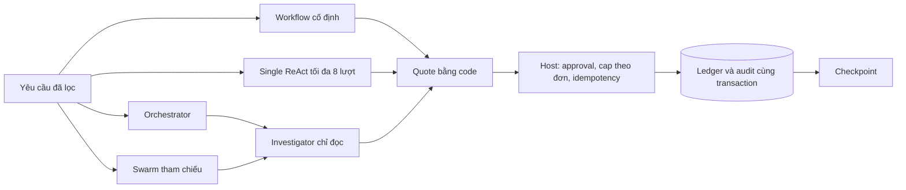

# Architecture — Problem Solver

Workflow không gọi model. Single dùng adapter Python chọn tool đọc trong run_react; lời MockLLM chỉ mô phỏng và tính budget. Orchestrator dùng plan/aggregate, handoff allowlist, investigator tuần tự. Ba shape chia sẻ ClaimRun trong src/lab8/shapes/workflow.py, nằm trong tập file grader cho phép chép. Investigator không có quyền ghi; host nhận quote đầy đủ, kiểm duyệt và chỉ ghi phần còn đủ điều kiện.

Nguồn sự thật là order theo principal và policy current/effective, không phải ticket. Một claim tối đa một refund; audit commit cùng transaction. Trace chỉ ghi field vận hành đã lọc; InjectedCrash đi ra harness để resume. B3 đối chiếu delay_days/status/damage_verified với fresh order trước cả nhánh quote 0, tối đa một lần sửa.

[Báo cáo nhóm](../report/team/group_report.md) · [ADR](../report/team/decision_adr.md) · [HTML](../presentation/index.html)

<!-- lab8-flow-links:start -->
## Luồng xử lý chi tiết — phụ lục

Sơ đồ tổng quan được giữ trong [architecture.md](architecture.md). Sáu luồng được diễn giải bằng tiếng Việt dễ đọc trong [phụ lục Mermaid](flow_details.md): [quy trình cố định](flow_details.md#workflow), [một tác nhân](flow_details.md#single), [bộ điều phối](flow_details.md#orchestrator), [nhiều vai mô phỏng](flow_details.md#swarm), [cổng ghi tiền](flow_details.md#host), [kiểm chứng B3](flow_details.md#b3).

Đọc từ trái sang phải. Trên HTML, mỗi lựa chọn hiển thị toàn bộ luồng trong một sơ đồ liền mạch, không chia phần hay chuyển trang. Có zoom, xem trọn luồng và mở rộng; toàn bộ hình nằm sẵn trong file local. Tên hàm và đường dẫn được chuyển xuống bảng đối chiếu kỹ thuật.
<!-- lab8-flow-links:end -->
