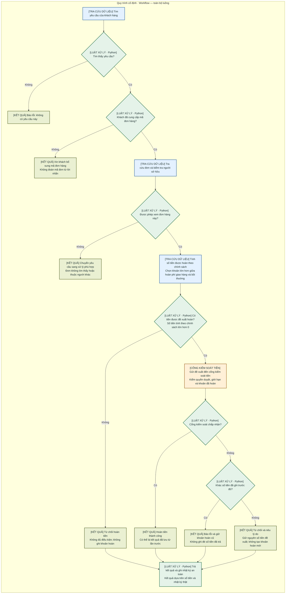
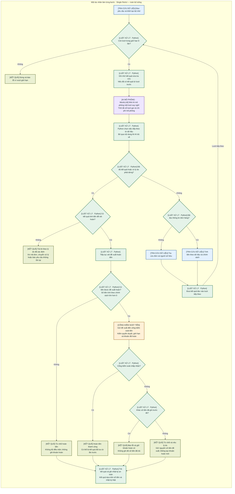
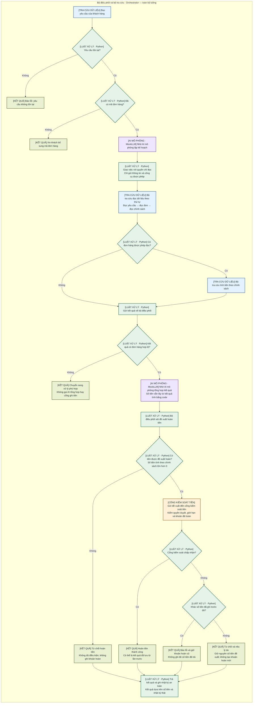
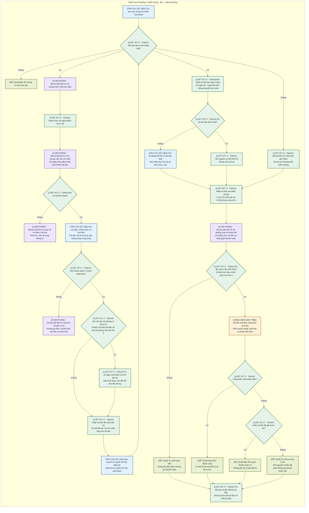

# Phụ lục — Sáu luồng xử lý Lab 08

Sinh từ `scripts/lab8_readable_flows.py` bằng `python scripts/build_flow_docs.py`. Sơ đồ dùng ngôn ngữ dễ đọc; mỗi kiến trúc là một luồng đầy đủ, không chia thành từng phần. [Báo cáo chính](../report/team/group_report.md) · [Tổng quan kiến trúc](architecture.md) · [HTML offline](../presentation/index.html#flows).

## Chú giải và cách đọc

Hình thoi là câu hỏi Có/Không. Nhãn và màu cùng giúp phân biệt: AI mô phỏng (tím), luật xử lý Python (xanh lá), tra cứu dữ liệu (xanh dương), cổng kiểm soát tiền (cam), sổ dữ liệu SQLite (xám), kết quả (olive), gián đoạn/lỗi (đỏ). Tên hàm và đường dẫn nằm ở bảng kỹ thuật sau mỗi hình, giúp người đọc tập trung vào việc đang xảy ra.

Tên kết quả trong chương trình: hoàn thành = resolved; cần thêm thông tin = needs_info; chuyển xử lý = escalated; từ chối = denied; lỗi = failed. ‘Số tiền đề xuất’ là khoản tính theo chính sách; ‘tiền thực trả’ là khoản sau khi xét quyền duyệt và giới hạn. Khi bị gián đoạn, bộ chạy gọi lại cùng dữ liệu để khôi phục, không tự trả thêm tiền.

## So sánh bốn kiến trúc

| Kiến trúc | Điều phối | Vai trò MockLLM | Quyền ghi | Điều kiện dừng | Rủi ro |
| --- | --- | --- | --- | --- | --- |
| Quy trình cố định | Làm theo các bước Python đã viết sẵn | Không cần gọi AI | Cổng kiểm soát ghi tiền | Có kết quả hoặc gặp nhánh phải dừng | Sai luật hoặc sai dữ liệu đầu vào |
| Một tác nhân | Lặp: quan sát, chọn việc, tra cứu | Mô phỏng suy nghĩ; lời trả về không chọn hành động | Cổng kiểm soát, nằm ngoài vòng chọn công cụ | Có kết luận hoặc đủ 8 lượt | Chọn sai việc, mất thông tin hoặc vượt số lượt |
| Bộ điều phối | Giao việc chỉ đọc rồi tập hợp kết quả | Mô phỏng lập kế hoạch và tổng hợp | Bộ điều phối gọi cổng; bộ tra cứu không ghi | Đầu vào thiếu, không đọc được đơn hoặc đã xét xong | Giao thiếu thông tin, cấp sai quyền, thêm chi phí |
| Nhiều vai mô phỏng | Các vai lần lượt xử lý, không chạy song song | Mô phỏng ý kiến, đọc lời nhắn và soạn phản hồi | Cổng kiểm soát ghi tiền | Thiếu thông tin, không đọc được đơn hoặc đã xét xong | Lỗi cố ý tin số ngày khách nói thay cho dữ liệu thật |

## Quy trình cố định · Workflow

- **Đầu vào:** Mã yêu cầu hoàn tiền và dữ liệu đơn hàng trong hệ thống.
- **Các bước:** Tìm yêu cầu → kiểm tra chủ đơn → tính tiền → xin phép ghi khoản hoàn.
- **Ai quyết định:** Python làm theo các bước cố định; không cần gọi AI.
- **Đầu ra:** Hoàn tiền, từ chối, xin thêm thông tin, chuyển xử lý hoặc báo lỗi.
- **Khác biệt:** Đơn giản và dễ kiểm soát: số tiền luôn được tính bằng luật đã viết sẵn.

Đối chiếu: [`src/lab8/shapes/workflow.py`](../src/lab8/shapes/workflow.py), [`src/lab8/tools.py`](../src/lab8/tools.py), [`src/lab8/shapes/common.py`](../src/lab8/shapes/common.py), [`src/lab8/durability.py`](../src/lab8/durability.py).

### Đối chiếu kỹ thuật

Các nhãn trong hình là diễn giải thân thiện; bảng này giữ liên kết với chương trình.

| Bước trong hình | Hàm hoặc nhánh tương ứng | File |
| --- | --- | --- |
| Tìm yêu cầu của khách hàng | `get_claim_view(claim_id)` | [`src/lab8/tools.py`](../src/lab8/tools.py) |
| Báo lỗi: không có yêu cầu này | `failed / unknown_claim` | [`src/lab8/shapes/workflow.py`](../src/lab8/shapes/workflow.py) |
| Xin khách bổ sung mã đơn hàng | `needs_info` | [`src/lab8/shapes/workflow.py`](../src/lab8/shapes/workflow.py) |
| Tra cứu đơn và kiểm tra người sở hữu | `lookup_order(order_id, principal_id)` | [`src/lab8/tools.py`](../src/lab8/tools.py) |
| Chuyển yêu cầu sang xử lý phù hợp | `escalated` | [`src/lab8/shapes/workflow.py`](../src/lab8/shapes/workflow.py) |
| Tính số tiền được hoàn theo chính sách | `compute_compensation → compensation.quote` | [`src/lab8/tools.py`](../src/lab8/tools.py) |
| Từ chối hoàn tiền | `finish(status='denied', proposal_amount=0)` | [`src/lab8/shapes/common.py`](../src/lab8/shapes/common.py) |
| Gửi đề xuất đến cổng kiểm soát tiền | `issue_refund(claim_id, full_quote, crash_at=...)` | [`src/lab8/durability.py`](../src/lab8/durability.py) |
| Hoàn tiền thành công | `finish(status='resolved', proposal_amount=full_quote)` | [`src/lab8/shapes/common.py`](../src/lab8/shapes/common.py) |
| Báo lỗi và giữ khoản hoàn cũ | `outcome.conflict → failed` | [`src/lab8/shapes/workflow.py`](../src/lab8/shapes/workflow.py) |
| Từ chối và nêu lý do | `outcome.ok=False, conflict=False → denied` | [`src/lab8/shapes/workflow.py`](../src/lab8/shapes/workflow.py) |
| Trả kết quả và ghi nhật ký an toàn | `finish(...) → RunResult` | [`src/lab8/shapes/common.py`](../src/lab8/shapes/common.py) |

- Lời nhắn của khách không thay thế dữ liệu đơn hàng. Không tự cộng hai loại bồi thường.
- Số tiền đề xuất có thể khác tiền thực trả, vì cổng kiểm soát còn trừ khoản đã hoàn và áp dụng giới hạn.

## Một tác nhân làm từng bước · Single ReAct

- **Đầu vào:** Yêu cầu đã được đọc cùng bộ nhớ ban đầu rỗng.
- **Các bước:** Quan sát → nhờ AI mô phỏng suy nghĩ → Python chọn việc → đọc dữ liệu → quan sát tiếp.
- **Ai quyết định:** Python chọn hành động; lời AI trả về không quyết định bước tiếp theo.
- **Đầu ra:** Kết luận sớm, dừng sau tối đa 8 lượt, hoặc gửi đề xuất cho cổng kiểm soát tiền.
- **Khác biệt:** Có vòng lặp nhưng quyền hành động vẫn bị giới hạn; AI không tự chọn số tiền hay ghi khoản hoàn.

Đối chiếu: [`src/lab8/shapes/single.py`](../src/lab8/shapes/single.py), [`src/lab8/runtime.py`](../src/lab8/runtime.py), [`src/lab8/mock_llm.py`](../src/lab8/mock_llm.py), [`src/lab8/tools.py`](../src/lab8/tools.py), [`src/lab8/shapes/workflow.py`](../src/lab8/shapes/workflow.py).

### Đối chiếu kỹ thuật

Các nhãn trong hình là diễn giải thân thiện; bảng này giữ liên kết với chương trình.

| Bước trong hình | Hàm hoặc nhánh tương ứng | File |
| --- | --- | --- |
| Đọc yêu cầu và khởi tạo bộ nhớ | `get_claim_view; state={}; observation={'claim':claim}` | [`src/lab8/shapes/single.py`](../src/lab8/shapes/single.py) |
| Còn lượt trong giới hạn 8 lần? | `run_react(max_steps=8)` | [`src/lab8/runtime.py`](../src/lab8/runtime.py) |
| Dừng và báo lỗi vì vượt giới hạn | `failed / step_cap` | [`src/lab8/runtime.py`](../src/lab8/runtime.py) |
| Ghi nhớ kết quả vừa tra cứu | `decide: state[last_tool]=last_result` | [`src/lab8/shapes/single.py`](../src/lab8/shapes/single.py) |
| Nhờ AI mô phỏng một lượt suy nghĩ | `complete(purpose='react'); Budget.add_llm` | [`src/lab8/mock_llm.py`](../src/lab8/mock_llm.py) |
| Python chọn việc tiếp theo từ dữ liệu | `decide(observation)` | [`src/lab8/shapes/single.py`](../src/lab8/shapes/single.py) |
| Tra cứu đơn và người sở hữu | `dispatch: lookup_order` | [`src/lab8/runtime.py`](../src/lab8/runtime.py) |
| Tính tiền theo dữ liệu và chính sách | `dispatch: compute_compensation` | [`src/lab8/runtime.py`](../src/lab8/runtime.py) |
| Đưa kết quả đọc vào lượt tiếp theo | `seen={last_tool,last_result,claim}` | [`src/lab8/runtime.py`](../src/lab8/runtime.py) |
| Có kết quả tính tiền để xét hoàn? | `if 'quote' in final` | [`src/lab8/shapes/single.py`](../src/lab8/shapes/single.py) |
| Trả lời theo lý do đã xác định | `needs_info / escalated / failed` | [`src/lab8/shapes/single.py`](../src/lab8/shapes/single.py) |
| Tiếp tục xét đề xuất hoàn tiền | `ClaimRun.settle(final['quote'], crash_at)` | [`src/lab8/shapes/workflow.py`](../src/lab8/shapes/workflow.py) |
| Từ chối hoàn tiền | `finish(status='denied', proposal_amount=0)` | [`src/lab8/shapes/common.py`](../src/lab8/shapes/common.py) |
| Gửi đề xuất đến cổng kiểm soát tiền | `issue_refund(claim_id, full_quote, crash_at=...)` | [`src/lab8/durability.py`](../src/lab8/durability.py) |
| Hoàn tiền thành công | `finish(status='resolved', proposal_amount=full_quote)` | [`src/lab8/shapes/common.py`](../src/lab8/shapes/common.py) |
| Báo lỗi và giữ khoản hoàn cũ | `outcome.conflict → failed` | [`src/lab8/shapes/single.py`](../src/lab8/shapes/single.py) |
| Từ chối và nêu lý do | `outcome.ok=False, conflict=False → denied` | [`src/lab8/shapes/single.py`](../src/lab8/shapes/single.py) |
| Trả kết quả và ghi nhật ký an toàn | `finish(...) → RunResult` | [`src/lab8/shapes/common.py`](../src/lab8/shapes/common.py) |

- Ngay cả lượt kết luận cũng gọi AI mô phỏng trước khi Python quyết định. Lượt AI này không xuất lệnh để chạy công cụ.
- Yêu cầu bình thường đi qua ba lượt: đọc đơn, tính tiền, kết luận. Tám lượt là giới hạn bảo vệ của hệ thống.

## Bộ điều phối và bộ tra cứu · Orchestrator

- **Đầu vào:** Yêu cầu của khách hàng và phạm vi đơn hàng được phép xem.
- **Các bước:** Kiểm tra đầu vào → mô phỏng lập kế hoạch → giao việc chỉ đọc → tập hợp kết quả → xét hoàn tiền.
- **Ai quyết định:** Bộ điều phối giữ quyền quyết định; bộ tra cứu chỉ đọc dữ liệu.
- **Đầu ra:** Kết quả xử lý yêu cầu, với khoản hoàn do cổng kiểm soát cho phép.
- **Khác biệt:** Phân vai rõ ràng nhưng bộ tra cứu vẫn chạy tuần tự, không chạy song song.

Đối chiếu: [`src/lab8/shapes/orchestrator.py`](../src/lab8/shapes/orchestrator.py), [`src/lab8/runtime.py`](../src/lab8/runtime.py), [`src/lab8/handoff.py`](../src/lab8/handoff.py), [`src/lab8/tools.py`](../src/lab8/tools.py), [`src/lab8/mock_llm.py`](../src/lab8/mock_llm.py), [`src/lab8/shapes/workflow.py`](../src/lab8/shapes/workflow.py).

### Đối chiếu kỹ thuật

Các nhãn trong hình là diễn giải thân thiện; bảng này giữ liên kết với chương trình.

| Bước trong hình | Hàm hoặc nhánh tương ứng | File |
| --- | --- | --- |
| Đọc yêu cầu của khách hàng | `get_claim_view` | [`src/lab8/tools.py`](../src/lab8/tools.py) |
| Báo lỗi: yêu cầu không tồn tại | `failed` | [`src/lab8/shapes/workflow.py`](../src/lab8/shapes/workflow.py) |
| Xin khách bổ sung mã đơn hàng | `needs_info` | [`src/lab8/shapes/workflow.py`](../src/lab8/shapes/workflow.py) |
| Nhờ AI mô phỏng lập kế hoạch | `complete(purpose='plan')` | [`src/lab8/mock_llm.py`](../src/lab8/mock_llm.py) |
| Giao việc với quyền chỉ đọc | `make_handoff: handoff.v1, allowlist` | [`src/lab8/handoff.py`](../src/lab8/handoff.py) |
| Bộ tra cứu đọc dữ liệu theo thứ tự | `run_readonly_investigators; worker=True` | [`src/lab8/runtime.py`](../src/lab8/runtime.py) |
| Bộ tra cứu tính tiền theo chính sách | `dispatch: compute_compensation` | [`src/lab8/tools.py`](../src/lab8/tools.py) |
| Gửi kết quả về bộ điều phối | `return claim_view + tools` | [`src/lab8/runtime.py`](../src/lab8/runtime.py) |
| Chuyển sang xử lý phù hợp | `escalated` | [`src/lab8/shapes/workflow.py`](../src/lab8/shapes/workflow.py) |
| Nhờ AI mô phỏng tổng hợp kết quả | `complete(purpose='aggregate')` | [`src/lab8/mock_llm.py`](../src/lab8/mock_llm.py) |
| Bộ điều phối xét đề xuất hoàn tiền | `ClaimRun.settle` | [`src/lab8/shapes/workflow.py`](../src/lab8/shapes/workflow.py) |
| Từ chối hoàn tiền | `finish(status='denied', proposal_amount=0)` | [`src/lab8/shapes/common.py`](../src/lab8/shapes/common.py) |
| Gửi đề xuất đến cổng kiểm soát tiền | `issue_refund(claim_id, full_quote, crash_at=...)` | [`src/lab8/durability.py`](../src/lab8/durability.py) |
| Hoàn tiền thành công | `finish(status='resolved', proposal_amount=full_quote)` | [`src/lab8/shapes/common.py`](../src/lab8/shapes/common.py) |
| Báo lỗi và giữ khoản hoàn cũ | `outcome.conflict → failed` | [`src/lab8/shapes/orchestrator.py`](../src/lab8/shapes/orchestrator.py) |
| Từ chối và nêu lý do | `outcome.ok=False, conflict=False → denied` | [`src/lab8/shapes/orchestrator.py`](../src/lab8/shapes/orchestrator.py) |
| Trả kết quả và ghi nhật ký an toàn | `finish(...) → RunResult` | [`src/lab8/shapes/common.py`](../src/lab8/shapes/common.py) |

- Bộ tra cứu không được tạo phiếu duyệt hoặc ghi tiền. Hệ thống từ chối cấp công cụ ghi cho vai trò này.
- Hai lần gọi AI chỉ mô phỏng lập kế hoạch và tổng hợp; các lời trả về không thay đổi danh sách công cụ hay cách tính tiền.

## Nhiều vai mô phỏng tuần tự · Swarm

- **Đầu vào:** Yêu cầu, lời nhắn khách hàng và dữ liệu đơn hàng.
- **Các bước:** Đọc → mô phỏng ý kiến → tra cứu → thử lỗi cố ý → phản hồi → xét hoàn.
- **Ai quyết định:** Python chạy các bước; AI chỉ mô phỏng trao đổi và soạn lời.
- **Đầu ra:** Kết quả xử lý yêu cầu cùng số tiền thực được phép ghi.
- **Khác biệt:** Cố ý giữ một lỗi tin lời khách để so sánh độ tin cậy.

Đối chiếu: [`src/lab8/shapes/swarm_reference.py`](../src/lab8/shapes/swarm_reference.py), [`src/lab8/mock_llm.py`](../src/lab8/mock_llm.py), [`src/lab8/runtime.py`](../src/lab8/runtime.py), [`src/lab8/tools.py`](../src/lab8/tools.py), [`src/lab8/durability.py`](../src/lab8/durability.py).

```mermaid
flowchart LR
  subgraph panel_swarm_whole["Nhiều vai mô phỏng tuần tự · Swarm — toàn bộ luồng"]
    rstart["[TRA CỨU DỮ LIỆU] Tìm yêu cầu và đọc lời nhắn của khách"]:::read
    rfound{"[LUẬT XỬ LÝ · Python] Tìm thấy yêu cầu?"}:::python
    runknown["[KẾT QUẢ] Báo lỗi: không có yêu cầu này"]:::result
    rpeer["[AI MÔ PHỎNG · MockLLM] Nhờ AI mô phỏng một ý kiến ban đầu"]:::llm
    rparsepy["[LUẬT XỬ LÝ · Python] Python đọc số ngày khách nói bị trễ"]:::python
    rparseai["[AI MÔ PHỎNG · MockLLM] Nhờ AI mô phỏng việc đọc lời nhắn<br/>Số ngày dùng tiếp là kết quả Python đã đọc"]:::llm
    rid{"[LUẬT XỬ LÝ · Python] Đã có mã đơn hàng?"}:::python
    rneed["[AI MÔ PHỎNG · MockLLM] Nhờ AI soạn lời xin thêm mã đơn<br/>Kết thúc: cần bổ sung thông tin"]:::llm
    rinvestigate["[TRA CỨU DỮ LIỆU] Tra cứu đơn, chính sách và tính tiền<br/>Chỉ đọc; lần lượt từng việc, không chạy song song"]:::read
    rvisible{"[LUẬT XỬ LÝ · Python] Đơn thuộc phạm vi được phép đọc?"}:::python
    resc["[AI MÔ PHỎNG · MockLLM] Nhờ AI soạn lời chuyển xử lý<br/>Không ghi tiền; chuyển yêu cầu đến nơi phù hợp"]:::llm
    rweak{"[LUẬT XỬ LÝ · Python] Rơi vào lần mô phỏng có lỗi cố ý?<br/>Khách nói khác dữ liệu và mã mô phỏng chia hết cho 5"}:::python
    roverride["[LUẬT XỬ LÝ · Python] Tin số ngày của khách và tính tiền lại<br/>Đây là lỗi được cài sẵn để làm đối chứng"]:::python
    rcandidate["[LUẬT XỬ LÝ · Python] Nhận số tiền đề xuất hiện tại<br/>Có thể đã sai vì tin lời nhắn thay cho dữ liệu"]:::python
    rdraft["[AI MÔ PHỎNG · MockLLM] Nhờ AI mô phỏng soạn lời phản hồi<br/>AI không chọn số tiền và không ghi khoản hoàn"]:::llm
    rpositive{"[LUẬT XỬ LÝ · Python] Có tiền được đề xuất hoàn?<br/>Số tiền tính theo chính sách lớn hơn 0"}:::python
    rzero["[KẾT QUẢ] Từ chối hoàn tiền<br/>Không đủ điều kiện; không ghi khoản hoàn"]:::result
    rhost["[CỔNG KIỂM SOÁT TIỀN] Gửi đề xuất đến cổng kiểm soát tiền<br/>Kiểm quyền duyệt, giới hạn và khoản đã hoàn"]:::host
    rok{"[LUẬT XỬ LÝ · Python] Cổng kiểm soát chấp nhận?"}:::python
    ryes["[KẾT QUẢ] Hoàn tiền thành công<br/>Có thể là kết quả đã lưu từ lần trước"]:::result
    rconflict{"[LUẬT XỬ LÝ · Python] Khác số tiền đã ghi trước đó?"}:::python
    rfailed["[KẾT QUẢ] Báo lỗi và giữ khoản hoàn cũ<br/>Không ghi đè số tiền đã trả"]:::result
    rno["[KẾT QUẢ] Từ chối và nêu lý do<br/>Giữ nguyên số tiền đề xuất; không tạo khoản hoàn mới"]:::result
    rend["[LUẬT XỬ LÝ · Python] Trả kết quả và ghi nhật ký an toàn<br/>Kết quả dựa trên sổ tiền và nhật ký thật"]:::python
    rstart --> rfound
    rfound -->|"Không"| runknown
    rfound -->|"Có"| rpeer
    rpeer --> rparsepy
    rparsepy --> rparseai
    rparseai --> rid
    rid -->|"Không"| rneed
    rid -->|"Có"| rinvestigate
    rinvestigate --> rvisible
    rvisible -->|"Không"| resc
    rvisible -->|"Có"| rweak
    rweak -->|"Có"| roverride
    rweak -->|"Không"| rcandidate
    roverride --> rcandidate
    rcandidate --> rdraft
    rdraft --> rpositive
    rpositive -->|"Không"| rzero
    rpositive -->|"Có"| rhost
    rhost --> rok
    rok -->|"Có"| ryes
    rok -->|"Không"| rconflict
    rconflict -->|"Có"| rfailed
    rconflict -->|"Không"| rno
    rzero --> rend
    ryes --> rend
    rfailed --> rend
    rno --> rend
  end
  classDef llm fill:#eee6ff,stroke:#7545ad,color:#182c2c,stroke-width:2px
  classDef python fill:#e5f3e9,stroke:#247049,color:#182c2c,stroke-width:2px
  classDef read fill:#e4f1ff,stroke:#2d639f,color:#182c2c,stroke-width:2px
  classDef host fill:#fff0d7,stroke:#9c6118,color:#182c2c,stroke-width:2px
  classDef sqlite fill:#e7ecf1,stroke:#4b6277,color:#182c2c,stroke-width:2px
  classDef result fill:#eaf0d2,stroke:#586728,color:#182c2c,stroke-width:2px
  classDef crash fill:#ffe8e3,stroke:#a34736,color:#182c2c,stroke-width:2px
```

### Đối chiếu kỹ thuật

Các nhãn trong hình là diễn giải thân thiện; bảng này giữ liên kết với chương trình.

| Bước trong hình | Hàm hoặc nhánh tương ứng | File |
| --- | --- | --- |
| Tìm yêu cầu và đọc lời nhắn của khách | `_run: SELECT selected claim fields` | [`src/lab8/shapes/swarm_reference.py`](../src/lab8/shapes/swarm_reference.py) |
| Báo lỗi: không có yêu cầu này | `failed / unknown_claim` | [`src/lab8/shapes/common.py`](../src/lab8/shapes/common.py) |
| Nhờ AI mô phỏng một ý kiến ban đầu | `complete(purpose='peer')` | [`src/lab8/mock_llm.py`](../src/lab8/mock_llm.py) |
| Python đọc số ngày khách nói bị trễ | `parse_delay_days(ticket)` | [`src/lab8/mock_llm.py`](../src/lab8/mock_llm.py) |
| Nhờ AI mô phỏng việc đọc lời nhắn | `complete(purpose='parse'); text ignored` | [`src/lab8/mock_llm.py`](../src/lab8/mock_llm.py) |
| Nhờ AI soạn lời xin thêm mã đơn | `draft → finish(needs_info)` | [`src/lab8/shapes/swarm_reference.py`](../src/lab8/shapes/swarm_reference.py) |
| Tra cứu đơn, chính sách và tính tiền | `make_handoff → run_readonly_investigators` | [`src/lab8/runtime.py`](../src/lab8/runtime.py) |
| Nhờ AI soạn lời chuyển xử lý | `draft → finish(escalated)` | [`src/lab8/shapes/swarm_reference.py`](../src/lab8/shapes/swarm_reference.py) |
| Rơi vào lần mô phỏng có lỗi cố ý? | `parsed_delay differs; seed % 5 == 0` | [`src/lab8/shapes/swarm_reference.py`](../src/lab8/shapes/swarm_reference.py) |
| Tin số ngày của khách và tính tiền lại | `order.delay_days=parsed_delay; compute_compensation` | [`src/lab8/shapes/swarm_reference.py`](../src/lab8/shapes/swarm_reference.py) |
| Nhận số tiền đề xuất hiện tại | `quote_payload` | [`src/lab8/shapes/swarm_reference.py`](../src/lab8/shapes/swarm_reference.py) |
| Nhờ AI mô phỏng soạn lời phản hồi | `complete(purpose='draft')` | [`src/lab8/mock_llm.py`](../src/lab8/mock_llm.py) |
| Từ chối hoàn tiền | `finish(status='denied', proposal_amount=0)` | [`src/lab8/shapes/common.py`](../src/lab8/shapes/common.py) |
| Gửi đề xuất đến cổng kiểm soát tiền | `issue_refund(claim_id, full_quote, crash_at=...)` | [`src/lab8/durability.py`](../src/lab8/durability.py) |
| Hoàn tiền thành công | `finish(status='resolved', proposal_amount=full_quote)` | [`src/lab8/shapes/common.py`](../src/lab8/shapes/common.py) |
| Báo lỗi và giữ khoản hoàn cũ | `outcome.conflict → failed` | [`src/lab8/shapes/swarm_reference.py`](../src/lab8/shapes/swarm_reference.py) |
| Từ chối và nêu lý do | `outcome.ok=False, conflict=False → denied` | [`src/lab8/shapes/swarm_reference.py`](../src/lab8/shapes/swarm_reference.py) |
| Trả kết quả và ghi nhật ký an toàn | `finish(...) → RunResult` | [`src/lab8/shapes/common.py`](../src/lab8/shapes/common.py) |

- Đây là luồng mô phỏng tuần tự: ý kiến AI → Python đọc số ngày → AI đọc lời nhắn → tra cứu → phản hồi. Không có trao đổi hai chiều hoặc nhiều người làm cùng lúc.
- Lời AI trả về không quyết định tiền. Cổng ghi tiền vẫn kiểm duyệt và giới hạn, nhưng không tính lại quyền được bồi thường.
- T02, mã mô phỏng 55: đơn thật trễ 2 ngày nhưng khách nói 5 ngày. Lỗi cố ý tạo đề xuất sai 20.000; cổng ghi tiền không tự sửa dữ kiện này.

## Cổng kiểm soát và ghi tiền · Host

- **Đầu vào:** Yêu cầu và toàn bộ số tiền đề xuất, chưa tự trừ khoản hoàn trước đó.
- **Các bước:** Kiểm chủ đơn → kiểm phiếu duyệt → trừ khoản đã hoàn và giới hạn tiền → chống ghi trùng → lưu an toàn.
- **Ai quyết định:** Code của cổng kiểm soát quyết quyền ghi; cơ sở dữ liệu bảo đảm lưu tiền và nhật ký cùng nhau.
- **Đầu ra:** Chấp nhận, từ chối, báo xung đột số tiền hoặc truyền lỗi để bộ chạy xử lý.
- **Khác biệt:** Không tính lại quyền bồi thường; kiểm duyệt và giới hạn tiền trước khi kiểm khoản hoàn cũ.

Đối chiếu: [`src/lab8/durability.py`](../src/lab8/durability.py), [`src/lab8/policy.py`](../src/lab8/policy.py), [`src/lab8/shapes/workflow.py`](../src/lab8/shapes/workflow.py), [`src/lab8/shapes/common.py`](../src/lab8/shapes/common.py).

```mermaid
flowchart LR
  subgraph panel_host_whole["Cổng kiểm soát và ghi tiền · Host — toàn bộ luồng"]
    hstart["[CỔNG KIỂM SOÁT TIỀN] Nhận yêu cầu ghi khoản hoàn<br/>Giữ riêng tiền đề xuất và tiền thực sẽ trả"]:::host
    hclaim{"[CỔNG KIỂM SOÁT TIỀN] Yêu cầu có tồn tại?"}:::host
    hunknown["[KẾT QUẢ] Từ chối: không có yêu cầu này<br/>Nhánh này không ghi nhật ký từ chối chính sách"]:::result
    howner{"[CỔNG KIỂM SOÁT TIỀN] Có đơn hàng đúng người yêu cầu?<br/>Phải có mã đơn, tìm thấy đơn và đúng chủ"}:::host
    hhistory[("[SỔ DỮ LIỆU · SQLite] Đọc tổng tiền các yêu cầu khác đã hoàn")]:::sqlite
    happroval[("[SỔ DỮ LIỆU · SQLite] Đọc đúng phiếu duyệt của yêu cầu này")]:::sqlite
    hvalid{"[CỔNG KIỂM SOÁT TIỀN] Phiếu duyệt hợp lệ và tiền dương?<br/>Đúng yêu cầu, chưa thu hồi, còn hạn; tiền duyệt và đề xuất đều dương"}:::host
    hcap["[CỔNG KIỂM SOÁT TIỀN] Trừ tiền đã hoàn và áp dụng giới hạn<br/>Không vượt tiền được duyệt hoặc phần khách đã trả còn lại"]:::host
    hpositive{"[CỔNG KIỂM SOÁT TIỀN] Sau khi giới hạn vẫn còn tiền để trả?"}:::host
    hdeny["[CỔNG KIỂM SOÁT TIỀN] Ghi lý do từ chối, không hoàn thêm<br/>Sai chủ đơn, phiếu duyệt không hợp lệ hoặc đã hoàn đủ"]:::host
    hcrashone{"[CỔNG KIỂM SOÁT TIỀN] Có thử dừng trước khi ghi tiền?"}:::host
    hstopone["[GIÁN ĐOẠN / LỖI] Gián đoạn khi chưa ghi khoản mới"]:::crash
    hexisting{"[CỔNG KIỂM SOÁT TIỀN] Yêu cầu này đã có khoản hoàn?"}:::host
    hequal{"[CỔNG KIỂM SOÁT TIỀN] Số tiền cũ khớp số vừa được duyệt?"}:::host
    hconflict["[KẾT QUẢ] Báo xung đột, giữ nguyên khoản cũ"]:::result
    hreplay["[CỔNG KIỂM SOÁT TIỀN] Dùng lại kết quả đã lưu, không trả thêm<br/>Cập nhật điểm khôi phục rồi trả thành công"]:::host
    hlock[("[SỔ DỮ LIỆU · SQLite] Bắt đầu lượt ghi có khóa bảo vệ")]:::sqlite
    hstable{"[CỔNG KIỂM SOÁT TIỀN] Lịch sử hoàn tiền vẫn chưa thay đổi?<br/>Đọc lại trong lúc giữ khóa ghi"}:::host
    hretry{"[CỔNG KIỂM SOÁT TIỀN] Hủy lượt ghi; còn một lần thử lại?"}:::host
    htryagain["[CỔNG KIỂM SOÁT TIỀN] Chạy lại từ đầu với dữ liệu mới<br/>Chỉ tự thử lại một lần"]:::host
    hchanged["[KẾT QUẢ] Từ chối vì lịch sử tiếp tục thay đổi"]:::result
    hsave[("[SỔ DỮ LIỆU · SQLite] Lưu khoản hoàn và nhật ký cùng nhau<br/>Cùng một giao dịch: hoặc lưu cả hai, hoặc không lưu")]:::sqlite
    hcrashtwo{"[CỔNG KIỂM SOÁT TIỀN] Có thử dừng sau khi đã ghi tiền?"}:::host
    hstoptwo["[GIÁN ĐOẠN / LỖI] Gián đoạn: tiền và nhật ký đã lưu<br/>Chưa kịp lưu điểm khôi phục mới"]:::crash
    hcheckpoint[("[SỔ DỮ LIỆU · SQLite] Lưu điểm khôi phục của yêu cầu")]:::sqlite
    hcrashthree{"[CỔNG KIỂM SOÁT TIỀN] Có thử dừng sau điểm khôi phục?"}:::host
    hstopthree["[GIÁN ĐOẠN / LỖI] Gián đoạn sau khi đã lưu đầy đủ"]:::crash
    hdone["[KẾT QUẢ] Xác nhận hoàn tiền thành công<br/>Trả số thực ghi; số đề xuất vẫn được giữ riêng"]:::result
    hresume["[LUẬT XỬ LÝ · Python] Bộ chạy gọi lại cùng yêu cầu và dữ liệu<br/>Không tạo khoản thứ hai nếu số tiền còn khớp"]:::python
    hstart --> hclaim
    hclaim -->|"Không"| hunknown
    hclaim -->|"Có"| howner
    howner -->|"Không"| hdeny
    howner -->|"Có"| hhistory
    hhistory --> happroval
    happroval --> hvalid
    hvalid -->|"Không"| hdeny
    hvalid -->|"Có"| hcap
    hcap --> hpositive
    hpositive -->|"Không"| hdeny
    hpositive -->|"Có"| hcrashone
    hcrashone -->|"Có"| hstopone
    hcrashone -->|"Không"| hexisting
    hexisting -->|"Có"| hequal
    hexisting -->|"Không"| hlock
    hequal -->|"Không"| hconflict
    hequal -->|"Có"| hreplay
    hlock --> hstable
    hstable -->|"Không"| hretry
    hstable -->|"Có"| hsave
    hretry -->|"Có"| htryagain
    hretry -->|"Không"| hchanged
    htryagain -->|"Thử lại một lần"| hstart
    hsave --> hcrashtwo
    hcrashtwo -->|"Có"| hstoptwo
    hcrashtwo -->|"Không"| hcheckpoint
    hcheckpoint --> hcrashthree
    hcrashthree -->|"Có"| hstopthree
    hcrashthree -->|"Không"| hdone
    hstopone --> hresume
    hstoptwo --> hresume
    hstopthree --> hresume
    hresume -->|"Chạy lại sau gián đoạn"| hstart
  end
  classDef llm fill:#eee6ff,stroke:#7545ad,color:#182c2c,stroke-width:2px
  classDef python fill:#e5f3e9,stroke:#247049,color:#182c2c,stroke-width:2px
  classDef read fill:#e4f1ff,stroke:#2d639f,color:#182c2c,stroke-width:2px
  classDef host fill:#fff0d7,stroke:#9c6118,color:#182c2c,stroke-width:2px
  classDef sqlite fill:#e7ecf1,stroke:#4b6277,color:#182c2c,stroke-width:2px
  classDef result fill:#eaf0d2,stroke:#586728,color:#182c2c,stroke-width:2px
  classDef crash fill:#ffe8e3,stroke:#a34736,color:#182c2c,stroke-width:2px
```

### Đối chiếu kỹ thuật

Các nhãn trong hình là diễn giải thân thiện; bảng này giữ liên kết với chương trình.

| Bước trong hình | Hàm hoặc nhánh tương ứng | File |
| --- | --- | --- |
| Nhận yêu cầu ghi khoản hoàn | `issue_refund(claim_id, proposed_vnd, crash_at)` | [`src/lab8/durability.py`](../src/lab8/durability.py) |
| Từ chối: không có yêu cầu này | `unknown_claim; no policy_denied` | [`src/lab8/durability.py`](../src/lab8/durability.py) |
| Có đơn hàng đúng người yêu cầu? | `claim.order_id; orders.principal_id == claim.principal_id` | [`src/lab8/durability.py`](../src/lab8/durability.py) |
| Đọc tổng tiền các yêu cầu khác đã hoàn | `order_refunded_vnd(exclude_claim_id=claim_id)` | [`src/lab8/policy.py`](../src/lab8/policy.py) |
| Đọc đúng phiếu duyệt của yêu cầu này | `claims.approval_id → approvals` | [`src/lab8/policy.py`](../src/lab8/policy.py) |
| Phiếu duyệt hợp lệ và tiền dương? | `authorize: claim match → valid status → expiry → positive amounts` | [`src/lab8/policy.py`](../src/lab8/policy.py) |
| Trừ tiền đã hoàn và áp dụng giới hạn | `proposed-already; min(approved); min(paid-already)` | [`src/lab8/policy.py`](../src/lab8/policy.py) |
| Ghi lý do từ chối, không hoàn thêm | `record_policy_denied → outcome.ok=False` | [`src/lab8/durability.py`](../src/lab8/durability.py) |
| Có thử dừng trước khi ghi tiền? | `crash_at == before_effect` | [`src/lab8/durability.py`](../src/lab8/durability.py) |
| Gián đoạn khi chưa ghi khoản mới | `InjectedCrash('before_effect')` | [`src/lab8/durability.py`](../src/lab8/durability.py) |
| Yêu cầu này đã có khoản hoàn? | `get_refund(claim_id)` | [`src/lab8/durability.py`](../src/lab8/durability.py) |
| Số tiền cũ khớp số vừa được duyệt? | `existing.amount_vnd == decision.amount_vnd` | [`src/lab8/durability.py`](../src/lab8/durability.py) |
| Báo xung đột, giữ nguyên khoản cũ | `_audit_conflict; conflict=True → shape failed` | [`src/lab8/durability.py`](../src/lab8/durability.py) |
| Dùng lại kết quả đã lưu, không trả thêm | `_checkpoint(existing); idempotent_replay` | [`src/lab8/durability.py`](../src/lab8/durability.py) |
| Bắt đầu lượt ghi có khóa bảo vệ | `BEGIN IMMEDIATE` | [`src/lab8/durability.py`](../src/lab8/durability.py) |
| Lịch sử hoàn tiền vẫn chưa thay đổi? | `re-read order_refunded_vnd == already` | [`src/lab8/durability.py`](../src/lab8/durability.py) |
| Hủy lượt ghi; còn một lần thử lại? | `rollback; if _retry` | [`src/lab8/durability.py`](../src/lab8/durability.py) |
| Chạy lại từ đầu với dữ liệu mới | `issue_refund(..., _retry=False)` | [`src/lab8/durability.py`](../src/lab8/durability.py) |
| Từ chối vì lịch sử tiếp tục thay đổi | `policy_denied / order_total_changed` | [`src/lab8/durability.py`](../src/lab8/durability.py) |
| Lưu khoản hoàn và nhật ký cùng nhau | `INSERT refund_ledger + refund_committed audit; commit` | [`src/lab8/durability.py`](../src/lab8/durability.py) |
| Có thử dừng sau khi đã ghi tiền? | `crash_at == after_effect_before_checkpoint` | [`src/lab8/durability.py`](../src/lab8/durability.py) |
| Gián đoạn: tiền và nhật ký đã lưu | `InjectedCrash('after_effect_before_checkpoint')` | [`src/lab8/durability.py`](../src/lab8/durability.py) |
| Lưu điểm khôi phục của yêu cầu | `_checkpoint(effect); commit separately` | [`src/lab8/durability.py`](../src/lab8/durability.py) |
| Có thử dừng sau điểm khôi phục? | `crash_at == after_checkpoint` | [`src/lab8/durability.py`](../src/lab8/durability.py) |
| Gián đoạn sau khi đã lưu đầy đủ | `InjectedCrash('after_checkpoint')` | [`src/lab8/durability.py`](../src/lab8/durability.py) |
| Xác nhận hoàn tiền thành công | `outcome.ok=True, reason='committed'; shape resolved` | [`src/lab8/durability.py`](../src/lab8/durability.py) |
| Bộ chạy gọi lại cùng yêu cầu và dữ liệu | `run_claim(... same DB, crash_at=None)` | [`src/tests/test_public_matrix.py`](../src/tests/test_public_matrix.py) |

- Cổng này kiểm quyền ghi và giới hạn tiền; không tự tính lại khách có thực sự đủ điều kiện bồi thường hay không.
- Ví dụ: đề xuất bồi thường 150.000, đơn đã nhận 30.000, thì chỉ trả thêm 120.000 nếu các giới hạn khác cho phép.
- Nếu đã có khoản hoàn, vẫn phải kiểm lại phiếu duyệt và tiền trước khi dùng lại kết quả. Dùng lại kết quả không đi qua điểm thử dừng sau điểm khôi phục.
- Nếu cơ sở dữ liệu báo ghi trùng: hủy lượt ghi, đọc khoản hiện có rồi dùng lại nếu khớp; khác tiền thì báo xung đột. Lỗi không xử lý được được truyền ra ngoài, không giả báo thành công.

## Nhiều vai mô phỏng + kiểm chứng · B3

- **Đầu vào:** Yêu cầu, lời nhắn khách hàng và dữ liệu đơn hàng.
- **Các bước:** Đọc → mô phỏng ý kiến → tra cứu → kiểm chứng dữ kiện → phản hồi → xét hoàn.
- **Ai quyết định:** Python kiểm chứng dữ kiện; cổng kiểm soát quyết quyền ghi tiền.
- **Đầu ra:** Kết quả xử lý yêu cầu cùng số tiền thực được phép ghi.
- **Khác biệt:** Có một lần kiểm chứng độc lập trước mọi quyết định ghi tiền.

Đối chiếu: [`src/bonus/swarm_verified.py`](../src/bonus/swarm_verified.py), [`src/lab8/mock_llm.py`](../src/lab8/mock_llm.py), [`src/lab8/runtime.py`](../src/lab8/runtime.py), [`src/lab8/tools.py`](../src/lab8/tools.py), [`src/lab8/durability.py`](../src/lab8/durability.py), [`src/bonus/verifier.py`](../src/bonus/verifier.py).

### Đối chiếu kỹ thuật

Các nhãn trong hình là diễn giải thân thiện; bảng này giữ liên kết với chương trình.

| Bước trong hình | Hàm hoặc nhánh tương ứng | File |
| --- | --- | --- |
| Tìm yêu cầu và đọc lời nhắn của khách | `_run: SELECT selected claim fields` | [`src/bonus/swarm_verified.py`](../src/bonus/swarm_verified.py) |
| Báo lỗi: không có yêu cầu này | `failed / unknown_claim` | [`src/lab8/shapes/common.py`](../src/lab8/shapes/common.py) |
| Nhờ AI mô phỏng một ý kiến ban đầu | `complete(purpose='peer')` | [`src/lab8/mock_llm.py`](../src/lab8/mock_llm.py) |
| Python đọc số ngày khách nói bị trễ | `parse_delay_days(ticket)` | [`src/lab8/mock_llm.py`](../src/lab8/mock_llm.py) |
| Nhờ AI mô phỏng việc đọc lời nhắn | `complete(purpose='parse'); text ignored` | [`src/lab8/mock_llm.py`](../src/lab8/mock_llm.py) |
| Nhờ AI soạn lời xin thêm mã đơn | `draft → finish(needs_info)` | [`src/bonus/swarm_verified.py`](../src/bonus/swarm_verified.py) |
| Tra cứu đơn, chính sách và tính tiền | `make_handoff → run_readonly_investigators` | [`src/lab8/runtime.py`](../src/lab8/runtime.py) |
| Nhờ AI soạn lời chuyển xử lý | `draft → finish(escalated)` | [`src/bonus/swarm_verified.py`](../src/bonus/swarm_verified.py) |
| Rơi vào lần mô phỏng có lỗi cố ý? | `parsed_delay differs; seed % 5 == 0` | [`src/bonus/swarm_verified.py`](../src/bonus/swarm_verified.py) |
| Tin số ngày của khách và tính tiền lại | `order.delay_days=parsed_delay; compute_compensation` | [`src/bonus/swarm_verified.py`](../src/bonus/swarm_verified.py) |
| Nhận số tiền đề xuất hiện tại | `quote_payload` | [`src/bonus/swarm_verified.py`](../src/bonus/swarm_verified.py) |
| Đọc lại đơn từ nguồn dữ liệu đáng tin | `verify_order → dispatch lookup_order(worker=True)` | [`src/bonus/verifier.py`](../src/bonus/verifier.py) |
| Đặt số tiền về 0 để tránh ghi nhầm | `verifier_rejected; verifier_order_not_visible` | [`src/bonus/verifier.py`](../src/bonus/verifier.py) |
| Đối chiếu ba dữ kiện quan trọng | `delay_days, status, damage_verified; verifier_check` | [`src/bonus/verifier.py`](../src/bonus/verifier.py) |
| Giữ nguyên số tiền đã tính | `return candidate, quote_payload` | [`src/bonus/verifier.py`](../src/bonus/verifier.py) |
| Tính lại đúng một lần từ dữ liệu thật | `compute_compensation(trusted); verifier_override; repair_round=1` | [`src/bonus/verifier.py`](../src/bonus/verifier.py) |
| Nhận số tiền sau kiểm chứng | `verify_order returns corrected quote` | [`src/bonus/swarm_verified.py`](../src/bonus/swarm_verified.py) |
| Nhờ AI mô phỏng soạn lời phản hồi | `complete(purpose='draft')` | [`src/lab8/mock_llm.py`](../src/lab8/mock_llm.py) |
| Từ chối hoàn tiền | `finish(status='denied', proposal_amount=0)` | [`src/lab8/shapes/common.py`](../src/lab8/shapes/common.py) |
| Gửi đề xuất đến cổng kiểm soát tiền | `issue_refund(claim_id, full_quote, crash_at=...)` | [`src/lab8/durability.py`](../src/lab8/durability.py) |
| Hoàn tiền thành công | `finish(status='resolved', proposal_amount=full_quote)` | [`src/lab8/shapes/common.py`](../src/lab8/shapes/common.py) |
| Báo lỗi và giữ khoản hoàn cũ | `outcome.conflict → failed` | [`src/bonus/swarm_verified.py`](../src/bonus/swarm_verified.py) |
| Từ chối và nêu lý do | `outcome.ok=False, conflict=False → denied` | [`src/bonus/swarm_verified.py`](../src/bonus/swarm_verified.py) |
| Trả kết quả và ghi nhật ký an toàn | `finish(...) → RunResult` | [`src/lab8/shapes/common.py`](../src/lab8/shapes/common.py) |

- Đây là luồng mô phỏng tuần tự: ý kiến AI → Python đọc số ngày → AI đọc lời nhắn → tra cứu → phản hồi. Không có trao đổi hai chiều hoặc nhiều người làm cùng lúc.
- Lời AI trả về không quyết định tiền. Cổng ghi tiền vẫn kiểm duyệt và giới hạn, nhưng không tính lại quyền được bồi thường.
- T02, mã mô phỏng 55: khách nói trễ 5 ngày, đơn thật ghi 2 ngày. Bước kiểm chứng sửa đề xuất 20.000 về 0, rồi từ chối hoàn tiền.
- Kiểm chứng dữ kiện luôn diễn ra trước khi xét số tiền bằng 0 và trước khi ghi tiền. Không đọc được đơn để kiểm chứng thì luồng hiện tại trả số tiền 0 và từ chối.
