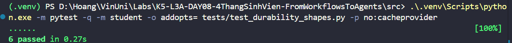

# Báo cáo cá nhân — 2A202603397_VoHuyHoang

## 1. Thông tin thành viên

- Họ tên: Võ Huy Hoàng
- MSSV: 2A202603397
- Email: 26ai.hoangvh4@vinuni.edu.vn
- GitHub: https://github.com/ferr2764

## 2. Phần việc phụ trách

CP2: Kiểm thử các shape đã viết. CP3: Kiểm chứng idempotency và crash/resume.

CP4: Chạy crash suite, kiểm tra approval, giới hạn hoàn tiền theo đơn, handoff, trace và secret.

CP5: Chạy benchmark bốn shape với năm seed, phân tích trial fail, tổng hợp số liệu và kiểm tra bài nộp.

Vai trò D — Test/Host, phụ trách kiểm thử workflow, single và orchestrator; bổ sung test. Kiểm thử crash/resume bổ sung phục vụ CP3–CP4.

## 3. Đóng góp cụ thể

- Bổ sung `src/tests/test_durability_shapes.py`, test `test_resume_other_crash_windows_keeps_one_refund`.
- Tham số hóa ba shape và hai điểm crash `before_effect`, `after_checkpoint`, tạo thành 6 ca kiểm thử. Đây là hai cửa sổ crash bổ sung cho T12 có sẵn (`after_effect_before_checkpoint`).
- Kiểm tra `InjectedCrash` thực sự xảy ra, cùng trạng thái ledger, audit và checkpoint ngay sau crash.
- Resume rồi retry trên cùng database; kiểm tra kết quả qua `trial_pass`, đúng một refund, một audit `refund_committed` và có checkpoint sau phục hồi.
- Sử dụng fixture `public_db`; đã bỏ marker `student` theo thông báo bổ sung để sáu ca test đóng góp chạy trong cổng host mặc định. Không sửa host, policy, metric hoặc dữ liệu chuẩn.
- CP3: trực tiếp chạy T11 và T12 trên workflow, single, orchestrator và swarm; cả hai nhóm kiểm thử đều đạt 4/4 ca.
- CP4: chạy crash suite đạt 20/20, tạo `src/reports/crash.json`; chạy các nhóm test approval, public matrix, bảo mật và durability bổ sung đều pass.
- Commit chứa file test bổ sung: `d70fc4a` — `Final CP2`.
- Commit điều chỉnh test đóng góp: `791521c` — `test: run durability contribution in default host suite`, author Võ Huy Hoàng, email `vhhoang27062@gmail.com`.
- CP5: tạo `src/reports/benchmark.json` với 4 shape × 14 claim × 5 seed (280 trial), xác định trial fail duy nhất của swarm và chạy `lab8.check_submission` để phân loại các mục tài liệu cần hoàn thiện.

## 4. Bằng chứng

File test: [test_durability_shapes.py](../../src/tests/test_durability_shapes.py).

Sau khi bỏ marker `student`, chạy riêng bằng lệnh mặc định đạt **6 passed in 0.37s**:

```powershell
.\.venv\Scripts\python.exe -m pytest -q tests/test_durability_shapes.py -p no:cacheprovider
```

Các lệnh có `-m student` bên dưới là bằng chứng lịch sử trước thay đổi marker; để chạy lại file test này ở phiên bản hiện tại, dùng lệnh mặc định ở trên.

Lệnh chạy từ thư mục `src/`:

```powershell
.\.venv\Scripts\python.exe -m pytest -q -m student -o addopts= tests/test_durability_shapes.py -p no:cacheprovider
```

Kết quả xác minh: **6 passed in 0.27s**. 


Kết quả này chỉ xác nhận sáu ca test bổ sung, không thay thế toàn bộ bộ student, crash suite 20/20 hoặc benchmark.

### CP3 — T11: Retry không tạo refund trùng

Chạy trong `src/`, bằng môi trường `.venv` với Python 3.12.10 và pytest 8.4.2:

```powershell
.\.venv\Scripts\python.exe -m pytest -vv -m student -o addopts= -k t11 -p no:cacheprovider
```

Kết quả terminal: **4 passed, 323 deselected in 0.25s**.

### CP3 — T12: Crash trước checkpoint rồi resume

```powershell
.\.venv\Scripts\python.exe -m pytest -vv -m student -o addopts= -k t12 -p no:cacheprovider
```

Kết quả terminal: **4 passed, 323 deselected in 0.22s**.

| Shape | T11 — Retry cùng claim | T12 — Crash/resume |
| --- | --- | --- |
| workflow | PASSED | PASSED |
| single | PASSED | PASSED |
| orchestrator | PASSED | PASSED |
| swarm | PASSED | PASSED |

T11 xác nhận gọi lại cùng claim trên cùng database không tạo thêm refund. T12 xác nhận crash tại `after_effect_before_checkpoint` thực sự xảy ra và sau resume vẫn chỉ có một refund, với kết quả được đối chiếu bằng `trial_pass`. Không có ca fail hoặc error trong hai lần chạy này. Đây là bằng chứng cho T11/T12, chưa thay thế kết quả toàn bộ host, crash suite 20/20 hoặc benchmark.

### Kiểm tra tích hợp CP2–CP3

Lần kiểm tra toàn bộ host và student ghi nhận **327 passed in 8.93s**. Khi xác minh, dùng thư mục tạm riêng cho `--basetemp` để tránh lỗi quyền truy cập Temp mặc định; không thay đổi cấu hình pytest của repo.

```powershell
$testTemp = Join-Path $PWD ('.pytest-review-' + [guid]::NewGuid().ToString('N'))
.\.venv\Scripts\python.exe -m pytest -q -o addopts= -p no:cacheprovider --basetemp="$testTemp"
```

Lệnh này bỏ bộ lọc mặc định để chạy cả host và student. Kết quả xác nhận bộ test hiện có đều xanh, chưa kết luận pass rate hidden hoặc số liệu benchmark.

### CP4 — Crash safety, approval và bảo mật

Các lệnh dưới đây chạy trong `src/`; kết quả ghi nhận từ terminal:

| Kiểm tra | Kết quả |
| --- | --- |
| Crash suite chính thức | crash_safety 20/20 |
| Approval và giới hạn hoàn tiền theo đơn | 11 passed in 0.30s |
| Public matrix bốn shape | 248 passed in 7.61s |
| Handoff, secret, trace contract và workflow safety | 18 passed in 0.46s |
| Durability bổ sung ba shape | 6 passed in 0.25s |

```powershell
.\.venv\Scripts\python.exe -m lab8.crash_test --count 20 --out reports/crash.json
.\.venv\Scripts\python.exe -m pytest -q tests/test_authorization.py tests/test_order_cap_and_approval_binding.py -p no:cacheprovider
.\.venv\Scripts\python.exe -m pytest -q -m student -o addopts= tests/test_public_matrix.py -p no:cacheprovider
.\.venv\Scripts\python.exe -m pytest -q tests/test_handoff_secret.py tests/test_trace_contract.py tests/test_workflow_safety.py -p no:cacheprovider
.\.venv\Scripts\python.exe -m pytest -q -m student -o addopts= tests/test_durability_shapes.py -p no:cacheprovider
```

Bằng chứng crash: [crash.json](../../src/reports/crash.json), với `count = 20`, `passed = 20`, mọi scenario đều có `passed = true`.

Rà các điểm ghi log/trace bằng:

```powershell
Select-String -Path lab8/shapes/workflow.py,lab8/shapes/single.py,lab8/shapes/orchestrator.py -Pattern 'print\(|trace\.add|logging|parent_secret|raw_headers'
```

Các điểm trace ghi quyết định, mã claim/order, quote, điểm crash và handoff đã sanitize. Trace investigator dùng order view từ tool đọc có allowlist. Trong kết quả tìm kiếm, `parent_secret` chỉ xuất hiện ở lời nhắc trong docstring orchestrator; không thấy lệnh in trực tiếp claim/order row thô tại các điểm đã rà. Các test bảo mật nêu trên pass; kết luận giới hạn trong code và tình huống được kiểm tra, chưa thay thế đánh giá hidden.

### CP5 — Benchmark và kiểm tra bài nộp

Trước benchmark, chạy toàn bộ test bằng lệnh sau và ghi nhận **327 passed in 9.89s**:

```powershell
.\.venv\Scripts\python.exe -m pytest -q -o addopts= -p no:cacheprovider
.\.venv\Scripts\python.exe -m lab8.benchmark --shapes workflow,single,orchestrator,swarm --cases data/public_claims.jsonl --seeds 11,22,33,44,55 --out reports/benchmark.json
```

Bằng chứng: [benchmark.json](../../src/reports/benchmark.json). Mỗi shape có 70 trial; các trial dùng cùng 14 claim, seed `11,22,33,44,55`, MockLLM, bảng giá và `as_of = 2026-11-15`, với SQLite mới cho từng trial.

| Shape | Pass rate | Pass^5 | Seed min–max | Variance | Cost/success (VND mô phỏng) | Mean / p95 steps |
| --- | ---: | ---: | --- | ---: | ---: | --- |
| workflow | 1.000 | 1.000 | 1.000–1.000 | 0.000000 | 27.86 | 1.64 / 2 |
| single | 1.000 | 1.000 | 1.000–1.000 | 0.000000 | 29.65 | 2.00 / 2 |
| orchestrator | 1.000 | 1.000 | 1.000–1.000 | 0.000000 | 46.43 | 2.79 / 3 |
| swarm | 0.986 | 0.929 | 0.929–1.000 | 0.000816 | 49.57 | 2.80 / 3 |

Đọc các trial có `passed = false` trong JSON xác nhận chỉ một trial fail: swarm, `C-002`, seed `55`, lý do `status resolved != denied`, run ID `R-swarm-C-002-s55`. Đây là điểm yếu đối chứng dự kiến khi swarm tin số ngày trong ticket. Ba shape nhóm viết đều đạt 70/70 trial.

Đề xuất gửi cho người phụ trách ADR: workflow có cùng độ đúng và variance bằng 0 như single/orchestrator trên public, đồng thời cost/success thấp nhất. Run ID dẫn chứng: `R-workflow-C-001-s11`. Đây là đề xuất dựa trên public; không thay thế quyết định ADR của nhóm hoặc đánh giá hidden. Chi phí là mô phỏng; latency `unavailable`.

```powershell
.\.venv\Scripts\python.exe -m lab8.check_submission
```


### Tự kiểm student_drop không có nhãn

Đã có đủ `hidden_claims.jsonl` và `hidden_world_state.json` trong `src/student_drop/`. Chạy từ `src/`:

```powershell
.\.venv\Scripts\python.exe -m lab8.benchmark --shapes workflow,single,orchestrator --cases student_drop/hidden_claims.jsonl --world student_drop/hidden_world_state.json --seeds 11,22,33,44,55 --out reports/hidden_selfcheck.json
```

Bằng chứng: [hidden_selfcheck.json](../../src/reports/hidden_selfcheck.json). Hoàn thành **600 trial** (3 shape × 40 claim × 5 seed), mỗi shape 200 trial. Cả 600 trial có `reason = unlabeled`, không có `status = error` hoặc cảnh báo trace/leak từ bộ tự kiểm. Dữ liệu không có nhãn nên không tính pass rate chính thức, không kết luận đạt ngưỡng hidden hoặc bonus. Không commit thư mục `student_drop/`.

## 6. Tự đánh giá

Đã có test bổ sung cho hai cửa sổ crash trên ba shape, kiểm tra dữ liệu cả trước và sau phục hồi. Cần nắm rõ vì sao checkpoint không thay thế ledger và retry không được tạo thêm refund hoặc audit hoàn tiền.

Đã hoàn thành phần chạy test, crash suite, benchmark public, tự kiểm 600 trial không có nhãn. Kết quả và giới hạn được ghi trong các mục bằng chứng trên. Việc còn lại: commit tài liệu và bằng chứng, chạy lại checker sau commit và phối hợp nhóm kiểm tra push/nộp LMS. Chưa ghi nhận hoàn tất các bước nộp bài này.
