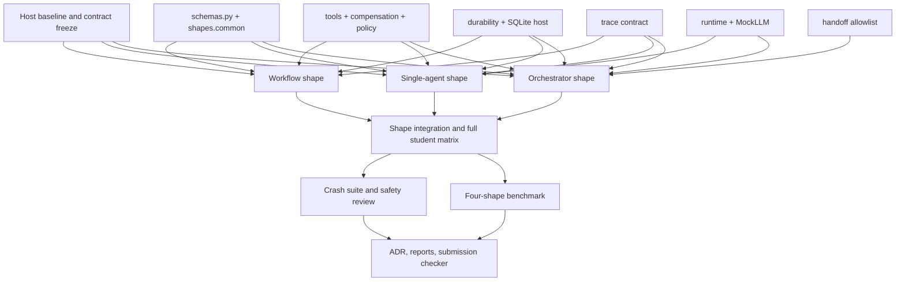

# Implementation Plan: Claim Shape Implementation

**Branch**: `001-claim-shape-implementation` | **Date**: 2026-11-16 | **Spec**: [spec.md](spec.md)

**Input**: Feature specification from `specs/001-claim-shape-implementation/spec.md`

## Summary

Implement the required workflow, single-agent, and orchestrator claim-processing shapes using
the existing `lab8` host, tool, schema, runtime, handoff, durability, and trace contracts.
Establish the shared result and safety contracts before parallel work, then implement the
three isolated shape modules and validate them through the existing student tests, crash suite,
benchmark, and submission checker. No host or grading architecture changes are planned.

## Technical Context

**Language/Version**: Python 3.11–3.13 (repository-supported)

**Primary Dependencies**: Existing `lab8` package; pytest 8.x and PyYAML 6.x from `src/requirements.txt`; seeded MockLLM

**Storage**: Existing SQLite world/refund ledger via `lab8.db` and `lab8.durability`

**Testing**: pytest; existing public contract and host tests, student matrix, crash test, benchmark, and submission checker

**Target Platform**: Windows, macOS, and Linux, as supported by the repository

**Project Type**: Python teaching-lab package and command-line validation tools

**Performance Goals**: No latency or throughput target is defined. Compare existing cost/step/variance metrics under the prescribed benchmark conditions.

**Constraints**: Preserve the shared `run_claim` contract; keep money/policy/approval/writes host-controlled; use full quote; honor idempotency/crash semantics; keep traces/handoffs free of protected data; do not edit protected host, policy, metric, config, or data files; no real model API or secrets.

**Scale/Scope**: Three student shapes plus the provided swarm reference; 14 public claims, five specified benchmark seeds, and a 40-claim × 5-seed instructor hidden evaluation of the selected shape.

## Constitution Check

*GATE: Must pass before Phase 0 research. Re-check after Phase 1 design.*

| Gate | Check | Result |
|---|---|---|
| Source scope | Requirements trace to README, assignment docs, rubric, and `spec.md`; no extra product behavior or technology is proposed. | PASS |
| Existing architecture | Reuse `schemas`, `shapes.common`, tools, runtime, handoff, host durability, trace, tests, and CLI tools; no new runtime architecture. | PASS |
| Shared contracts first | Freeze the existing shape/result/refund/trace/handoff interfaces before parallel shape work. | PASS |
| Ownership and isolation | Assign one named owner per task and shape module; each member uses their own branch and does not edit another owner's module. Team roster/owner names must be filled in the task breakdown before implementation. | PASS WITH PRE-IMPLEMENTATION ACTION |
| Verification | Every task records test evidence or reproducible verification instructions; PR review checks scope, contracts, acceptance criteria, and evidence. | PASS |
| Required before bonus | Complete required shapes and required checks before any bonus topic. | PASS |

No constitution violation is identified. The post-design check is recorded after the module and integration design below.

## Project Structure

### Documentation (this feature)

```text
specs/001-claim-shape-implementation/
├── plan.md
├── research.md
├── data-model.md
├── quickstart.md
├── contracts/
│   ├── run-claim.md
│   └── shape-integration.md
└── tasks.md             # Created by /speckit.tasks
```

### Source Code (repository root)

```text
src/
├── lab8/
│   ├── shapes/
│   │   ├── workflow.py          # Shape A; dedicated owner
│   │   ├── single.py            # Shape B; dedicated owner
│   │   ├── orchestrator.py      # Shape C; dedicated owner
│   │   ├── common.py            # Shared result/trace composition; reuse, no changes absent approved need
│   │   └── swarm_reference.py   # Shape D reference; read-only
│   ├── schemas.py               # Shared types/status/run ID; read-only contract
│   ├── tools.py                 # Read/quote adapters; protected
│   ├── runtime.py               # ReAct and read-only dispatch; protected
│   ├── handoff.py               # Sanitized handoff allowlist; protected
│   ├── durability.py            # Approval, caps, ledger, idempotency; protected
│   └── trace.py                 # Trace writer; reuse existing contract
├── tests/
│   ├── test_public_matrix.py     # Existing student matrix; do not alter to make tests pass
│   ├── test_*_shape.py          # Separate added test files owned by the corresponding shape owner
│   └── ...                      # Existing host/contract tests; preserve
└── reports/
    ├── benchmark.json           # Generated by integration owner; do not hand-edit
    └── crash.json               # Generated by integration owner; do not hand-edit

report/team/
├── decision_adr.md              # Shared deliverable; one integration owner coordinates edits
├── research_card.md
└── group_report.md
```

**Structure Decision**: Retain the existing single Python package and host boundaries. Each
student shape is an independent implementation module behind the same public callable. Shared
schemas, runtime, tools, and durability are contracts/dependencies, not parallel implementation
targets. Add shape-owned tests in separate files under the existing `src/tests/` directory.

## Module Responsibilities

| Module | Responsibility | Owner/edit policy |
|---|---|---|
| `src/lab8/shapes/workflow.py` | Fixed-step claim path; computes via existing tools, applies result rules, calls host, and composes result/trace. | One assigned member; independently implementable after shared contract freeze. |
| `src/lab8/shapes/single.py` | Bounded ReAct path (maximum 8 steps); model selects read tools only; host call remains shape/code-controlled. | One assigned member; independently implementable after shared contract freeze. |
| `src/lab8/shapes/orchestrator.py` | Orchestration and investigator path; builds allowlisted handoff, invokes read-only runtime, calls host from orchestrator. | One assigned member; depends on existing handoff/runtime contract. |
| `src/lab8/shapes/common.py` | Shared result/trace construction and ledger-derived fields. | Shared dependency; keep unchanged unless all owners agree on an approved contract need. |
| `src/lab8/schemas.py` | `RunResult`, `Budget`, `Quote`, statuses, and deterministic run ID. | Shared API contract; read-only during shape work. |
| `src/lab8/tools.py`, `compensation.py`, `policy.py` | Allowlisted reads and deterministic quote/policy behavior. | Existing shared host/tool boundary; protected from student edits. |
| `src/lab8/durability.py`, `db.py` | SQLite storage, approval/cap enforcement, idempotency, audit, crash injection. | Host boundary; protected from student edits. |
| `src/lab8/runtime.py`, `mock_llm.py` | Bounded ReAct/read-only investigator execution and seeded model stand-in. | Shared runtime; reuse without modification. |
| `src/lab8/handoff.py`, `trace.py` | Allowlisted investigator handoff and per-run trace writing. | Shared security contracts; reuse without modification. |
| `src/tests/test_*_shape.py` | Additional tests owned by a shape contributor; keep contributors in separate test files. | Parallel writable by distinct owners. |
| Existing tests, config, data, metrics, host modules | Baseline and grading source of truth. | Shared read-only; do not modify unless explicitly allowed by assignment. |
| `src/reports/*.json` | Generated benchmark/crash evidence. | Single integration operator generates; no concurrent writes or manual edits. |
| `report/team/*`, `TEAM.md` | Shared reports and contribution record. | One designated coordinator integrates edits; contributors provide owned sections/rows to avoid concurrent file conflicts. |

## Shared API Contracts

The canonical signatures, schemas, invariants, and error outcomes are documented in
[contracts/run-claim.md](contracts/run-claim.md) and
[contracts/shape-integration.md](contracts/shape-integration.md). Existing code is the source
of truth; this plan does not add or change a public interface.

## Dependency Graph



## Work Sequencing and Parallelism

1. **Foundation (serial, before splitting implementation):** name task owners; keep `python -m pytest -q` host baseline green; review the spec and existing contracts; agree on shared callable/result/refund/trace rules; record file ownership and separate test paths. Do not modify protected shared modules.
2. **Shape implementation (parallel):** one owner each for workflow, single, and orchestrator, on each member's own Git branch. Each owner adds shape tests in a separate test file and submits a PR. The orchestrator owner consumes the already-defined handoff/runtime contracts; no cross-shape code dependency is introduced.
3. **Integration (serial):** integrate through PR review; run the whole student matrix and host suite; resolve cross-shape regressions without editing another owner's module without agreement. Check `run_claim` outcomes, trace files, secrets/PII, cost counters, full quote, idempotency, and crash propagation.
4. **Evidence and submission (serial):** run crash suite and four-shape benchmark under the prescribed corpus/seeds; one integration owner generates report JSON; complete ADR/research/group/member reports from those generated results; run `check_submission`; do bonus only after mandatory criteria pass.

**Shared-file contention policy**:

- No two implementation owners edit the same shape module. A change to `schemas.py`, `common.py`, tools, runtime, handoff, durability, policy, metrics, config, or data requires stopping parallel work, agreement by affected owners, and assignment-compliant approval; protected files remain unmodified.
- Parallel test work is confined to distinct added test files. Existing `test_public_matrix.py` and host-contract tests are shared read-only gates.
- Use separate SQLite paths per run/member; do not share a live DB. Do not commit SQLite or trace artifacts.
- Reports and `TEAM.md` are shared resources; consolidate through one coordinator rather than concurrent edits. Generated reports have one writer per generation run.

## Integration and Verification Strategy

- **Before parallel work:** from `src/`, run `python -m lab8.smoke` and `python -m pytest -q`; confirm the existing host gate is green and record the result.
- **Per shape PR:** run the shape-selected student tests (`python -m pytest -q -m student -o addopts= -k workflow`, substituting `single` or `orchestrator`) and the host test suite; attach command/output and test additions. Verify shared contract cases from `docs/contracts.md`.
- **Integrated gate:** run `python -m pytest -q -m student -o addopts=` across T01–T14/five seeds and `python -m pytest -q`; retain expected behavior for the reference swarm without weakening tests.
- **Durability/security:** run `python -m lab8.crash_test --count 20 --out reports/crash.json`; inspect crash safety `20/20`. Verify retry T11, crash/resume T12, order-cap T13/T14, approval binding, trace freshness/schema, and secret/PII scans with existing tests/metrics. Do not catch `InjectedCrash` in a shape.
- **Benchmark:** after all four shapes are integrated, run the prescribed benchmark with at least 10 claims and seeds `11,22,33,44,55`; use generated report values, run ID, and commit hash in the ADR. Do not hand-edit JSON.
- **Submission:** run `python -m lab8.check_submission` and require `0 FAIL`; verify required reports and repo/LMS steps. Instructor hidden threshold is `>= 0.75`; bonus threshold is `>= 0.80` plus other stated prerequisites.

## Post-Design Constitution Check

| Principle | Design evidence | Result |
|---|---|---|
| Repository Sources Define Scope | Modules and acceptance gates trace to the spec, README, assignment docs, and rubric; no new feature/technology is selected. | PASS |
| Reuse the Existing Architecture | Existing `lab8` package, host, runtime, tools, schemas, tests, and commands are reused. | PASS |
| Tasks Have Owners and Verifiable Outcomes | Shape/test/report workstreams specify outputs and verification; named owners must be recorded in `/speckit.tasks` before work starts. | PASS WITH TASK-PLANNING ACTION |
| Agree on Shared Contracts Before Parallel Work | Existing contracts are captured in design artifacts and frozen before parallel implementation. | PASS |
| Isolated Ownership and Pull Request Review | Dedicated modules, branches, and PR integration; shared files have a single coordinator/controlled edit policy. | PASS |
| Required Before Bonus | Work sequence gates bonus behind required tests, safety, and submission prerequisites. | PASS |

No unjustified constitution violation. No complexity exception is requested.

## Complexity Tracking

No violations.

| Violation | Why Needed | Simpler Alternative Rejected Because |
|-----------|------------|-------------------------------------|
| None | No constitution violations identified. | Not applicable. |
