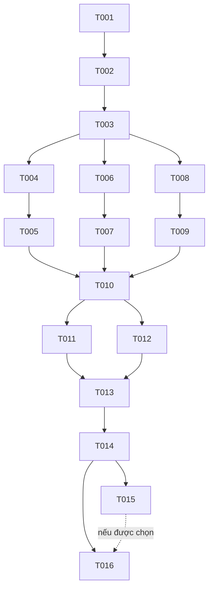

# Danh sách công việc: Triển khai các kiểu xử lý yêu cầu hoàn tiền

**Đầu vào**: Tài liệu thiết kế trong `specs/001-claim-shape-implementation/`

**Điều kiện tiên quyết**: `plan.md`, `spec.md`, `research.md`, `data-model.md`, `contracts/`, `quickstart.md`

**Kiểm thử**: Có các task kiểm thử vì mỗi user story trong `spec.md` xác định tiêu chí kiểm thử độc lập và repository yêu cầu bằng chứng kiểm thử/xác minh cho mỗi task.

**Tổ chức**: Công việc được nhóm theo năm câu chuyện người dùng trong `spec.md`. Giữ nguyên mã yêu cầu M-01…M-13 và O-01 từ ma trận yêu cầu.

**Phân công**: Thành viên 1–6 là nhãn vai trò vì chưa có danh sách tên nhóm. Thay bằng tên thật trong `docs/team-assignments.md` trước khi triển khai. Mỗi công việc dưới đây có đúng một người chịu trách nhiệm.

## Định dạng và trường thông tin của công việc

Mỗi công việc dùng định dạng `- [ ] Tnnn [P?] [USn?] ...`. Mô tả bao gồm mã yêu cầu, người phụ trách, đầu ra, tiêu chí nghiệm thu, (các) đường dẫn file dự kiến và phụ thuộc. Chỉ dùng `[P]` khi công việc có thể làm đồng thời mà không sửa cùng file hoặc chờ một công việc chưa hoàn thành.

## Giai đoạn 1: Thiết lập

**Mục đích**: Ghi lại quyền sở hữu cho sáu người, branch và ranh giới file trước khi bắt đầu.

- [X] T001 Yêu cầu: M-01, M-02, M-03, M-04, M-05, M-06, M-07, M-08, M-09, M-10, M-11, M-12, M-13, O-01. Phụ trách: Thành viên 1. Đầu ra: tạo bảng phân công sáu người, tên nhánh đề xuất, quyền sở hữu module/test/report và quy tắc giao tiếp/PR. Nghiệm thu: cả sáu vai trò có một luồng công việc chính; đường dẫn không chồng lấn khi triển khai song song; nêu rõ người sở hữu file dùng chung và các điểm bàn giao; có thể thay nhãn thành viên chưa rõ tên bằng tên thật. File: `docs/team-assignments.md`. Phụ thuộc: không.

---

## Giai đoạn 2: Nền tảng (Điều kiện tiên quyết, phải hoàn tất trước)

**Mục đích**: Xác minh các cổng hiện có và cố định interface/quyền sở hữu file dùng chung. Phải hoàn thành các task này trước mọi user story.

- [X] T002 Yêu cầu: M-09. Phụ trách: Thành viên 5. Đầu ra: chạy `python -m lab8.smoke` và `python -m pytest -q` từ `src/`, gửi nguyên văn kết quả lệnh cho Thành viên 1 để ghi nhận baseline. Nghiệm thu: smoke in `lab8.smoke pass`; pytest host kết thúc thành công (kết quả khởi đầu theo tài liệu là `52 passed, 248 deselected` trước khi thêm test); mọi sai lệch được báo cáo thay vì sửa file được bảo vệ. File: `src/README.md` (nguồn lệnh, không sửa), `docs/team-assignments.md` (Thành viên 1 điều phối ghi nhận baseline). Phụ thuộc: T001.
- [X] T003 Yêu cầu: M-01, M-02, M-03, M-04, M-05, M-06, M-07, M-08. Phụ trách: Thành viên 1. Đầu ra: ghi nhận thống nhất về hợp đồng và cổng phân quyền file dựa trên `contracts/run-claim.md`, `contracts/shape-integration.md`, `plan.md`. Nghiệm thu: cả sáu thành viên xác nhận trước khi làm song song rằng `run_claim`/`RunResult`, trạng thái và quy tắc trace, ranh giới host nhận toàn bộ quote, truyền lỗi crash, investigator chỉ đọc, nhánh riêng và đường dẫn shape/test không chồng lấn sẽ được giữ nguyên. File: `specs/001-claim-shape-implementation/contracts/run-claim.md`, `specs/001-claim-shape-implementation/contracts/shape-integration.md`, `docs/team-assignments.md`. Phụ thuộc: T001 và T002.

**Mốc kiểm tra**: Không bắt đầu công việc triển khai shape trước khi baseline xanh và T003 ghi nhận xác nhận hợp đồng/quyền sở hữu file. Nếu baseline không xanh, dừng và báo sai lệch; không sửa file host/test được bảo vệ để ép test pass.

**Trạng thái khi ghi nhận**: T002 được đánh dấu hoàn tất theo xác nhận của người dùng. Hợp đồng và ranh giới file được ghi trong `docs/team-assignments.md`; nhóm xác nhận đã thống nhất theo báo cáo của người dùng ngày 2026-11-17.

---

## Giai đoạn 3: Câu chuyện người dùng 1 - Triển khai shape workflow (Ưu tiên: P1, Bắt buộc)

**Mục tiêu**: Triển khai shape A workflow theo M-01–M-07.

**Kiểm thử độc lập**: Chạy student test cho workflow và các test hợp đồng/quy tắc nghiệp vụ liên quan đến kết quả thành công, từ chối, chạy lại, crash, trace và quyền riêng tư.

### Kiểm thử cho câu chuyện người dùng 1

- [ ] T004 [P] [US1] Yêu cầu: M-01, M-02, M-03, M-04, M-05, M-06, M-07. Phụ trách: Thành viên 2. Đầu ra: thêm regression test riêng cho workflow, bao phủ output `run_claim` dùng chung và các tiêu chí nghiệm thu của workflow. Nghiệm thu: test kiểm tra `RunResult` hợp lệ/kết thúc sớm, trace mới có run ID khớp, hành vi truyền toàn bộ quote và audit host, không refund khi thiếu dữ liệu/quote bằng 0, không lộ secret/PII, chạy lại/xung đột và truyền crash/resume; không sửa student matrix dùng chung. File: `src/tests/test_workflow_shape.py`. Phụ thuộc: T003.

### Triển khai cho câu chuyện người dùng 1

- [ ] T005 [P] [US1] Yêu cầu: M-01, M-02, M-03, M-04, M-05, M-06, M-07. Phụ trách: Thành viên 2. Đầu ra: thay stub workflow bằng luồng xử lý claim theo các bước cố định, dùng helper hiện có. Nghiệm thu: giữ nguyên `run_claim(claim_id, *, seed, store_path, crash_at=None) -> RunResult`; dùng claim/order/policy hiện hành có thẩm quyền; trả trạng thái theo hợp đồng; code tính quote; truyền toàn bộ quote và `crash_at` cho host; không bắt `InjectedCrash`; dùng helper chung để tạo result/trace; T004 và student test workflow đều pass. File: `src/lab8/shapes/workflow.py`. Phụ thuộc: T004; có thể làm song song với T007/T009 sau khi các test tương ứng hoàn tất.

**Mốc kiểm tra / lát cắt MVP**: Khi T005 pass kiểm thử độc lập, workflow trở thành lát cắt đầu tiên có thể trình diễn. Đây **chưa phải hoàn thành bài tập**. M-01 và benchmark bắt buộc vẫn cần Shape B, C cùng các cổng tích hợp/must-pass.

---

## Giai đoạn 4: Câu chuyện người dùng 2 - Triển khai shape single-agent (Ưu tiên: P1, Bắt buộc)

**Mục tiêu**: Triển khai shape B bằng interface ReAct có giới hạn và tool chỉ đọc hiện có theo M-01–M-07.

**Kiểm thử độc lập**: Chạy student test cho single-agent và các trường hợp kết quả, quy tắc nghiệp vụ, ngân sách, trace, chạy lại và crash liên quan.

### Kiểm thử cho câu chuyện người dùng 2

- [ ] T006 [P] [US2] Yêu cầu: M-01, M-02, M-03, M-04, M-05, M-06, M-07. Phụ trách: Thành viên 3. Đầu ra: thêm regression test riêng cho single-agent, bao phủ hợp đồng công khai và ranh giới ReAct. Nghiệm thu: test xác nhận tối đa 8 bước, model chỉ gọi tool đọc, code/host kiểm soát khoản bồi hoàn và thao tác ghi, kết quả theo hợp đồng, truyền toàn bộ quote, trace an toàn, chạy lại/crash; không sửa test dùng chung. File: `src/tests/test_single_shape.py`. Phụ thuộc: T003.

### Triển khai cho câu chuyện người dùng 2

- [ ] T007 [P] [US2] Yêu cầu: M-01, M-02, M-03, M-04, M-05, M-06, M-07. Phụ trách: Thành viên 3. Đầu ra: thay stub single-agent bằng luồng xử lý claim ReAct có giới hạn, dùng runtime và MockLLM hiện có. Nghiệm thu: giữ hợp đồng callable/result dùng chung; giới hạn `run_react` ở 8 bước; chỉ cho model dùng tool đọc; shape/code tính amount và gọi refund; truyền toàn bộ quote và crash injection cho host; tạo trace mới an toàn; T006 và student test single-agent đều pass. File: `src/lab8/shapes/single.py`. Phụ thuộc: T006; có thể làm song song với T005/T009 sau khi các test tương ứng hoàn tất.

**Mốc kiểm tra**: Shape B kiểm thử độc lập được mà không cần sửa Shape A/C hoặc file runtime dùng chung.

---

## Giai đoạn 5: Câu chuyện người dùng 3 - Triển khai shape orchestrator (Ưu tiên: P1, Bắt buộc)

**Mục tiêu**: Triển khai shape C và luồng investigator theo M-01–M-08.

**Kiểm thử độc lập**: Chạy test student cho orchestrator, bao gồm kết quả, handoff theo allowlist, tool chỉ đọc, trace an toàn và refund/crash.

### Kiểm thử cho câu chuyện người dùng 3

- [ ] T008 [P] [US3] Yêu cầu: M-01, M-02, M-03, M-04, M-05, M-06, M-07, M-08. Phụ trách: Thành viên 4. Đầu ra: thêm test riêng cho orchestrator, bao phủ handoff và xử lý claim. Nghiệm thu: test xác nhận allowlist cho field cấp cao nhất/facts, không có secret/raw parent context/tool ghi, investigator chỉ đọc, output/refund/trace đúng hợp đồng, chạy lại và truyền crash; không sửa `handoff.py`, `runtime.py` hoặc student test dùng chung. File: `src/tests/test_orchestrator_shape.py`. Phụ thuộc: T003.

### Triển khai cho câu chuyện người dùng 3

- [ ] T009 [P] [US3] Yêu cầu: M-01, M-02, M-03, M-04, M-05, M-06, M-07, M-08. Phụ trách: Thành viên 4. Đầu ra: thay stub orchestrator bằng cách dùng `make_handoff`, `run_readonly_investigators`, tools, host và helper result/trace dùng chung. Nghiệm thu: giữ hợp đồng callable/result dùng chung; investigator chỉ nhận facts đã sanitize theo allowlist và tool chỉ đọc; orchestrator giữ quyền gọi host ghi refund; truyền toàn bộ quote và crash injection; không ghi dữ liệu nhạy cảm vào trace/output; T008 và student test orchestrator đều pass. File: `src/lab8/shapes/orchestrator.py`. Phụ thuộc: T008; có thể làm song song với T005/T007 sau khi các test tương ứng hoàn tất.

**Mốc kiểm tra**: Cả ba shape P1 kiểm thử độc lập được. Chỉ bắt đầu tích hợp khi T005, T007 và T009 pass student test tương ứng.

---

## Giai đoạn 6: Câu chuyện người dùng 4 - Kiểm chứng và nộp bài (Ưu tiên: P1, Bắt buộc)

**Mục tiêu**: Xác minh M-09–M-13 và tạo bằng chứng có thể tái lập sau khi tích hợp ba shape.

**Kiểm thử độc lập**: Student matrix và host suite chạy xanh; crash report đạt `20/20`; benchmark bao phủ bốn shape, tối thiểu 10 claim và các seed `11,22,33,44,55`; report/checker đáp ứng rubric.

- [X] T010 [US4] Phụ trách: Thành viên 5. Yêu cầu: M-09, M-13. Đầu ra: sau khi T005/T007/T009 được merge qua PR, chạy toàn bộ host suite và student matrix; rà soát tính toàn vẹn/bảo mật rồi gửi kết quả cho Thành viên 1. Nghiệm thu: `python -m pytest -q` và `python -m pytest -q -m student -o addopts=` đều pass; giữ nguyên expected-miss assertion của swarm; không sửa file được bảo vệ hoặc report sinh tự động; test xác nhận nội dung ticket không thể ghi đè order/policy có thẩm quyền; không dùng real-model API/secret, sao chép reference weakness hoặc thiếu khai báo nguồn/đóng góp. File: `src/` (chỉ chạy test), `docs/team-assignments.md` (Thành viên 1 ghi bằng chứng). Phụ thuộc: T005, T007, T009.
- [X] T011 [P] [US4] Yêu cầu: M-06, M-09, M-10. Phụ trách: Thành viên 5. Đầu ra: tạo crash report bắt buộc bằng `python -m lab8.crash_test --count 20 --out reports/crash.json`. Nghiệm thu: report ghi `crash_safety` = `20/20`; chạy lại/resume chỉ có một refund và một audit `refund_committed`; output do công cụ sinh và không sửa tay. File: `src/reports/crash.json`. Phụ thuộc: T010.
- [X] T012 [P] [US4] Yêu cầu: M-10, M-11. Phụ trách: Thành viên 6. Đầu ra: tạo benchmark public cho cả bốn shape theo cases/seeds được chỉ định. Nghiệm thu: `src/reports/benchmark.json` do công cụ sinh cho `workflow,single,orchestrator,swarm`, tối thiểu 10 claim, seeds `11,22,33,44,55`; output có run ID để truy vết trong ADR và không sửa tay. File: `src/reports/benchmark.json`. Phụ thuộc: T010.
- [X] T013 [US4] Yêu cầu: M-11, M-12, M-13. Phụ trách: Thành viên 6. Đầu ra: hoàn thành ADR, research card, báo cáo nhóm và báo cáo cá nhân của từng thành viên dựa trên bằng chứng được sinh ra và template nộp bài. Nghiệm thu: ADR ghi shape được chọn, commit hash, run ID/số liệu benchmark và giới hạn bằng chứng; research card điền đủ trường bắt buộc; group report theo giới hạn trang; mỗi personal report đúng quy ước tên file và khai báo đóng góp/công cụ đã dùng. File: `report/team/decision_adr.md`, `report/team/research_card.md`, `report/team/group_report.md`, `report/team/MSSV_HoTen.md`, `TEAM.md`. Phụ thuộc: T011 và T012. Báo cáo nêu rõ các thiếu sót về test cá nhân, công cụ AI chưa được thành viên tự xác nhận và output chưa lưu; không coi các thiếu sót đó là đã đáp ứng rubric nộp bài.
- [ ] T014 [US4] Yêu cầu: M-09, M-12, M-13. Phụ trách: Thành viên 1. Đầu ra: chạy `python -m lab8.check_submission` và hoàn tất rà soát tính toàn vẹn/nộp bài. Nghiệm thu: checker in `0 FAIL`; các file bắt buộc và nhãn đúng quy định; xác nhận repository public hoặc người chấm có quyền truy cập và từng thành viên đã nộp link LMS; không commit secret, sqlite, trace, dữ liệu instructor hoặc report bị sửa tay. Ghi lại bằng chứng xác minh và các bước nộp bên ngoài còn chờ. File: `src/lab8/check_submission.py` (chỉ đọc/chạy), `docs/team-assignments.md`, `.gitignore`. Phụ thuộc: T013.

**Điểm tích hợp**: T010 là cổng tích hợp bắt buộc. T011 và T012 có thể chạy song song sau T010 vì tạo hai report file riêng; T013 phải đợi cả hai report. T014 là cổng cuối cho repository/nộp bài.

**Trạng thái T013**: Đã điền TEAM, ADR, research card, group report và báo cáo cá nhân cho năm MSSV duy nhất được ghi nhận (Đào Đức Duy được phân công hai vai trò). Tên/MSSV và commit evidence lấy từ assignment/Git history; thông tin không có trong workspace được đánh dấu chưa xác minh. Các thiếu sót rubric được nêu rõ trong TEAM và báo cáo; T014 cùng việc bổ sung test evidence cá nhân vẫn là cổng trước khi nộp. Hash chốt cần cập nhật sau commit report.

---

## Giai đoạn 7: Câu chuyện người dùng 5 - Hoàn thành chủ đề thưởng tùy chọn (Ưu tiên: P3, Thưởng)

**Mục tiêu**: O-01, chỉ khi nhóm quyết định chọn và đăng ký một chủ đề thưởng đã nêu sau khi hoàn thành phần bắt buộc.

**Kiểm thử độc lập**: Chủ đề được chọn có code/test/report/bằng chứng bắt buộc; kiểm thử nền tảng vẫn xanh; thỏa tất cả điều kiện must-pass và hidden pass rate `>= 0.80`.

- [ ] T015 [US5] Phụ trách: Thành viên 6. Yêu cầu: O-01. Đầu ra: nhóm đã chọn B7; tạo kiểm thử metamorphic, báo cáo kết quả và report bonus theo `docs/bonus_topics.md`. Nghiệm thu: `src/tests/test_bonus_grader_audit.py` pass; report JSON do test sinh và `report/team/bonus_report.md` có phân tích candidate; phải qua các gate bắt buộc trước khi bonus được tính. File: `src/tests/test_bonus_grader_audit.py`, `src/reports/bonus_grader_audit.json`, `report/team/bonus_report.md`. Phụ thuộc: T014 và xác minh gate bonus.

---

## Giai đoạn 8: Hoàn thiện và xác minh xuyên suốt

**Mục đích**: Chạy lại quy trình xác minh đã tài liệu hóa và khép các thiếu sót về bằng chứng/quyền sở hữu mà không mở rộng phạm vi.

- [ ] T016 Phụ trách: Thành viên 5. Yêu cầu: M-09, M-10, M-11, M-12, M-13. Đầu ra: chạy quy trình xác minh cuối trong `quickstart.md` từ `src/`, ghi lệnh/kết quả và mọi sai lệch vào `docs/team-assignments.md`. Nghiệm thu: có kết quả smoke, host/student tests, crash suite, kiểm tra benchmark artifact và submission checker; mỗi sai lệch có người xử lý, không che giấu bằng cách sửa data/metrics được bảo vệ. File: `specs/001-claim-shape-implementation/quickstart.md` (nguồn lệnh; không sửa trừ khi có lỗi tài liệu được duyệt), `docs/team-assignments.md`, `src/` (chỉ chạy lệnh). Phụ thuộc: T014; chỉ phụ thuộc T015 nếu nhóm đã chọn bonus.

---

## Phụ thuộc và thứ tự thực hiện

### Phụ thuộc giữa các giai đoạn

- **Giai đoạn 1 - Thiết lập**: T001 tạo bản đồ sáu người/quyền sở hữu file.
- **Giai đoạn 2 - Nền tảng**: T002 chạy baseline sau T001; T003 xác nhận contract/quyền sở hữu file sau T001/T002 và chặn mọi user story cho đến khi xong.
- **Các câu chuyện người dùng bắt buộc P1 (Giai đoạn 3–6)**: US1, US2, US3 độc lập sau Giai đoạn 2. US4 tích hợp phải đợi cả ba shape.
- **Chủ đề thưởng (Giai đoạn 7)**: Tùy chọn; đợi cổng nộp bài bắt buộc và quyết định chọn chủ đề.
- **Hoàn thiện (Giai đoạn 8)**: Đợi các cổng bắt buộc và, nếu có chọn, cả phần thưởng.

### Phụ thuộc giữa các câu chuyện người dùng

- **US1 (M-01–M-07)**: Bắt đầu sau T003; độc lập với US2/US3. Workflow là lát cắt MVP để trình diễn, không phải hoàn thành toàn bộ bài.
- **US2 (M-01–M-07)**: Bắt đầu sau T003; độc lập với US1/US3; chỉ phụ thuộc hợp đồng runtime/tools/host hiện có.
- **US3 (M-01–M-08)**: Bắt đầu sau T003; độc lập với US1/US2; dùng hợp đồng handoff/runtime hiện có.
- **US4 (M-09–M-13)**: T010 phụ thuộc cả ba shape. T011/T012 chạy đồng thời sau T010; T013 phụ thuộc cả hai; T014 đợi các đầu ra hoàn tất.
- **US5 (O-01)**: Tùy chọn; phụ thuộc hoàn thành phần bắt buộc, quyết định chọn B1–B7 và điều kiện đủ chuẩn cho chủ đề thưởng.

### Đồ thị phụ thuộc

### Cơ hội làm song song

- **Sau T003**: T004, T006, T008 là các công việc viết test có thể chạy song song trong những file riêng. Các công việc triển khai phụ thuộc là T005, T007, T009 cũng có thể chạy song song trên các module riêng sau khi test tương ứng hoàn tất.
- **Sau T010**: T011 tạo crash report và T012 tạo benchmark report có thể chạy song song; dùng đường dẫn output và store riêng.
- **Không làm song song**: T001–T003 tuần tự vì xác nhận cùng ranh giới phân công; T010 đợi các PR shape; T013 đợi cả hai report bằng chứng; T014 đợi tài liệu cuối; các chỉnh sửa report dùng chung do một người điều phối.

### Tóm tắt phân công sáu người

Xem bảng đầy đủ trong `docs/team-assignments.md`. Phân công đề xuất: Thành viên 1 điều phối tích hợp/hợp đồng/nộp bài; Thành viên 2 workflow; Thành viên 3 single-agent; Thành viên 4 orchestrator; Thành viên 5 baseline/tích hợp/crash/xác minh cuối; Thành viên 6 benchmark/báo cáo quyết định/chủ đề thưởng tùy chọn. Thay nhãn vai trò bằng tên thật trước khi bắt đầu.

## Chiến lược triển khai

### Mốc MVP

Hoàn tất Giai đoạn 1–2, sau đó bàn giao US1 (T004–T005) như lát cắt đầu tiên kiểm thử độc lập được. Đây chỉ là mốc trình diễn: để hoàn thành bài cần cả US2, US3, US4, ba điều kiện bắt buộc không thể bù điểm và các báo cáo bắt buộc.

### Bàn giao tăng dần

1. Xác nhận phân công sáu người, chạy cổng host chưa chỉnh sửa và cố định hợp đồng (T001–T003).
2. Triển khai/kiểm thử workflow (US1), sau đó triển khai/kiểm thử độc lập single-agent và orchestrator (US2/US3). Ba luồng này có thể chạy song song.
3. Tích hợp qua PR review rồi chạy cổng tích hợp tổng hợp (US4 T010).
4. Sinh crash report và benchmark song song, sau đó hoàn tất báo cáo và kiểm tra nộp bài cuối (US4 T011–T014).
5. Chỉ bắt đầu chủ đề thưởng nếu nhóm chọn và đủ điều kiện; kết thúc bằng việc ghi nhận kết quả xác minh quickstart.

## Ghi chú

- `[P]` nghĩa là không phụ thuộc công việc chưa hoàn thành và không xung đột khi ghi cùng file.
- Mỗi công việc có một người chịu trách nhiệm; Thành viên 1 điều phối ghi bằng chứng vào `docs/team-assignments.md` để tránh nhiều người sửa đồng thời.
- Cả sáu thành viên dùng Git branch riêng. Không ai sửa module do người khác phụ trách nếu chưa thống nhất; tích hợp qua PR review.
- Không coi host/runtime/config/data/metrics/public matrix hiện có là mục tiêu triển khai. Không sửa tay JSON report do công cụ sinh.
